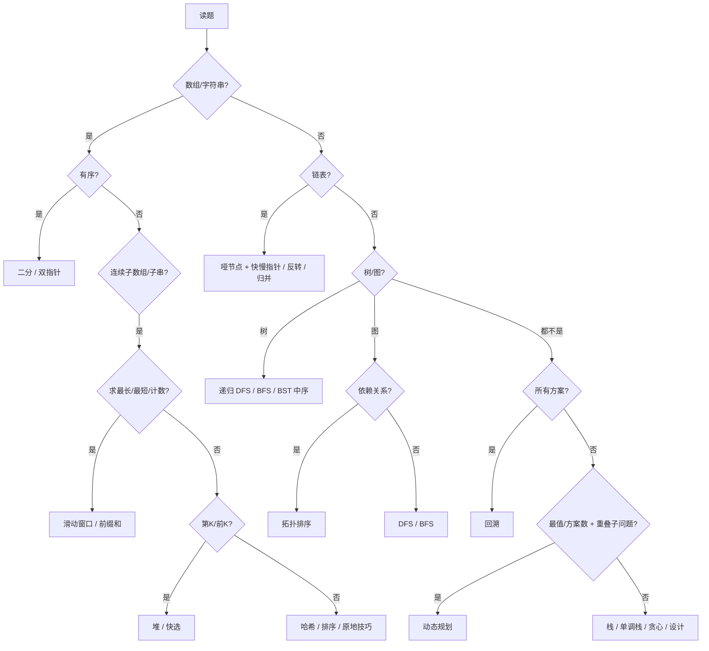

# Hot100 刷题攻略 · 18 个套路（Java 应试版）

> 配套本仓库：100 道 Hot100 + 100 份 Java 参考题解（`scripts/java-ref/`）+ 每题思路（`work/parts/explains-*.json`）。
>
> 目标：**看到题 → 30 秒判断套路 → 默写模板 → 补边界 → 通过**。
>
> 适用：秋招 / 春招 / 实习笔试面试前突击。建议先刷 P0 的 49 题，再补中等题，最后碰困难题。

---

## 目录

- [0. 怎么用这份文档](#0-怎么用这份文档)
- [1. 五步应试法](#1-五步应试法)
- [2. 30 秒题型识别](#2-30-秒题型识别)
- [3. 18 个套路与 Java 模板](#3-18-个套路与-java-模板)
- [4. 100 题速查表](#4-100-题速查表)
- [5. 7 天冲刺计划](#5-7-天冲刺计划)
- [6. 优先级：时间不够刷哪些](#6-优先级时间不够刷哪些)
- [7. Java 考场易错清单](#7-java-考场易错清单)
- [8. 考场应急策略](#8-考场应急策略)
- [9. 一页纸口诀与默写清单](#9-一页纸口诀与默写清单)

---

## 0. 怎么用这份文档

### 三步法

1. **背模板（1 天）**：只看第 3 章的 18 个模板，每个模板手写 2 遍，做到不看屏幕能默写。
2. **刷题映射（5 天）**：按第 5 章计划刷题。每道题先自己判断套路，再看速查表对答案；错题标记 `hot100 mark <id> star`。
3. **错题回炉（1 天）**：只重做错题 + 默写模板 + 背第 9 章口诀。

### 配合本仓库的命令

```bash
hot100 show <id> --explain        # 看题目、官方签名、参考题解
hot100 init <id>                  # 生成 sol-<id>.java 模板
hot100 judge <id>                 # 默认评测当前目录 sol-<id>.java（内置 + 扩展用例）
hot100 judge <id> custom.java     # 优先评测指定文件
hot100 mark <id> done             # 标记已刷
hot100 mark <id> star             # 收藏错题
hot100 random --unfinished        # 随机抽未完成的题
```

### 一个最重要的原则

> **先判断题型，再写代码。** 90% 的卡壳不是不会写，而是没认出套路。每道题先花 1 分钟问自己：题面信号是什么？对应第几号套路？

---

## 1. 五步应试法

每道题固定执行这五步，形成肌肉记忆：

| 步骤 | 动作 | 时间 |
|---|---|---|
| ① 读题圈信号 | 圈出关键词：有序 / 连续 / 第 K / 所有方案 / 最短 / 原地 / 树 / 图 | 1 min |
| ② 定套路与复杂度 | 说出「这是 XX 套路，时间 O(??)，空间 O(??)」 | 1 min |
| ③ 写骨架 | 直接套模板，先不管边界 | 5-8 min |
| ④ 补边界 | 空输入、单元素、重复、负数、极值 | 2 min |
| ⑤ 手推小样例 | 用 3~5 个元素走一遍，检查下标和指针 | 2 min |

**面试时**：先口述思路和复杂度，得到认可再写；边写边解释关键行。

---

## 2. 30 秒题型识别

### 2.1 关键词 → 第一反应

| 题面信号 | 第一反应 | 套路编号 |
|---|---|---|
| 有序数组、旋转有序、找左右边界 | 二分 | 05 |
| 连续子数组 / 子串 + 最长 / 最短 / 恰好 | 滑动窗口 或 前缀和 | 03 / 04 |
| 两数 / 三数之和、两端向中间 | 排序 + 对撞双指针 | 02 |
| 子数组和等于 K、路径和 | 前缀和 + 哈希 | 04 |
| 第 K 大 / 前 K 高频 / 流式中位数 | 堆 | 14 |
| 所有组合 / 排列 / 分割 / 棋盘放置 | 回溯 | 12 |
| 网格连通块 / 岛屿 | DFS / BFS | 10 |
| 最短步数 / 同时扩散 | 多源 BFS | 08 / 10 |
| 先修课 / 依赖关系 / 有向无环 | 拓扑排序 | 11 |
| 括号匹配 / 嵌套表达式 | 栈 | 13 |
| 下一个更大 / 更小、柱状图面积 | 单调栈 | 13 |
| 二叉树 | 递归（优先想后序） | 07 / 09 |
| 链表、删节点、反转、合并 | 哑节点 + 指针 | 06 |
| 区间合并 / 最少区间 | 排序 + 贪心 | 15 |
| 设计 O(1) | 哈希 + 双向链表 / 双栈 / 双堆 / Trie | 18 |
| 只出现一次、其他出现两次 | 异或 | 17 |
| 多数元素 | 摩尔投票 | 17 |
| 1..n 数组找重复 / 缺失 | 原地哈希 / Floyd 判圈 | 17 |
| 原地修改、O(1) 空间 | 双指针 / 三次翻转 / 首行首列标记 | 17 |
| 方案数 / 最值 + 重叠子问题 | 动态规划 | 16 |

### 2.2 数据规模 → 可接受复杂度

| n 的范围 | 可接受复杂度 | 常用算法 |
|---|---|---|
| ≤ 10 | O(n!) | 全排列、N 皇后 |
| ≤ 20 | O(2^n) | 子集、状压 |
| ≤ 100 | O(n^3) | 区间 DP、Floyd |
| ≤ 1000 | O(n^2) | 二维 DP、中心扩展 |
| ≤ 1e5 | O(n log n) | 排序、堆、二分、归并 |
| ≤ 1e6 | O(n) | 双指针、哈希、单调栈、滑动窗口 |

> 看到 `1 <= n <= 10^5` 就不要再想 O(n²)；看到 `n <= 20` 就想回溯 / 状压。

### 2.3 决策树



---

## 3. 18 个套路与 Java 模板

> 模板默认 `import java.util.*;`，链表题默认已有 `ListNode`，树题默认已有 `TreeNode`。
> 这些模板对齐本仓库 `scripts/java-ref/` 的写法与官方 Java 签名。

### 套路 01 · 哈希表

**识别信号**：两数之和、分组、去重、判断是否存在、计数、连续序列。

**一句话**：用空间换时间，把「找另一个数 / 找同类」变成 O(1) 查询。

**覆盖题**：1、49、128、560、138、146。

```java
// 两数之和：边遍历边查，先查后存（防止同一元素用两次）
Map<Integer, Integer> map = new HashMap<>();
for (int i = 0; i < nums.length; i++) {
    int need = target - nums[i];
    if (map.containsKey(need)) return new int[]{map.get(need), i};
    map.put(nums[i], i);
}
```

```java
// 字母异位词分组：排序后的字符串做 key
Map<String, List<String>> map = new HashMap<>();
for (String s : strs) {
    char[] cs = s.toCharArray();
    Arrays.sort(cs);
    String key = new String(cs);
    map.computeIfAbsent(key, k -> new ArrayList<>()).add(s);
}
return new ArrayList<>(map.values());
```

```java
// 最长连续序列：只从「x-1 不存在」的段首开始数
Set<Integer> set = new HashSet<>();
for (int x : nums) set.add(x);
int ans = 0;
for (int x : set) {
    if (set.contains(x - 1)) continue;
    int y = x;
    while (set.contains(y + 1)) y++;
    ans = Math.max(ans, y - x + 1);
}
```

**易错点**
- 两数之和必须「先查后存」，否则 `[3,3], target=6` 会返回 `[0,0]`。
- 字符计数用 `int[26]` / `int[128]` 比 `HashMap<Character,Integer>` 快。
- 连续序列必须从段首开始，否则退化成 O(n²)。

---

### 套路 02 · 双指针

**识别信号**：有序数组求和、两端逼近、原地删除/移动、链表找环/找中点/找倒数第 N。

**一句话**：利用有序性或链表结构，让两个指针单向移动，把 O(n²) 降到 O(n)。

**覆盖题**：11、15、42、283、160、206、234、141、142、19、24、75、287。

#### 变体 A：对撞双指针（有序 / 两端）

```java
int l = 0, r = n - 1;
while (l < r) {
    // 根据题意决定移动哪一边
    if (height[l] < height[r]) l++;   // 盛水容器：移动较矮的一侧
    else r--;
}
```

```java
// 三数之和：排序 + 固定 i + 双指针 + 跳重
Arrays.sort(nums);
for (int i = 0; i < n - 2; i++) {
    if (i > 0 && nums[i] == nums[i - 1]) continue;
    int l = i + 1, r = n - 1;
    while (l < r) {
        long sum = (long) nums[i] + nums[l] + nums[r];
        if (sum < 0) l++;
        else if (sum > 0) r--;
        else {
            res.add(Arrays.asList(nums[i], nums[l], nums[r]));
            while (l < r && nums[l] == nums[l + 1]) l++;
            while (l < r && nums[r] == nums[r - 1]) r--;
            l++; r--;
        }
    }
}
```

#### 变体 B：快慢 / 读写双指针

```java
// 移动零：快指针找非零，慢指针写
int slow = 0;
for (int fast = 0; fast < n; fast++) {
    if (nums[fast] != 0) {
        int t = nums[slow]; nums[slow] = nums[fast]; nums[fast] = t;
        slow++;
    }
}
```

#### 变体 C：链表快慢指针

```java
ListNode slow = head, fast = head;
while (fast != null && fast.next != null) {
    slow = slow.next;
    fast = fast.next.next;
    if (slow == fast) { /* 有环 */ }
}
```

**易错点**
- 三数之和去重：`i`、`l`、`r` 三处都要跳重。
- 盛水容器移动「较矮」的一侧，不是较高的一侧。
- 141/142：快指针初始化 `head`，循环条件 `fast != null && fast.next != null`。
- 142 环入口：相遇后一个指针从头出发，同速再相遇即入口。
- 287 寻找重复数：把 `nums[i]` 当下一个下标，等价于找环入口。

---

### 套路 03 · 滑动窗口

**识别信号**：连续子数组 / 子串，求最长、最短、恰好满足某条件、定长窗口。

**一句话**：右指针扩张、左指针收缩，窗口内维护计数，每个元素最多进出一次。

**覆盖题**：3、438、76、239（239 用单调队列）。

```java
// 可变窗口通用模板
int l = 0, ans = 0;
int[] cnt = new int[128];
for (int r = 0; r < n; r++) {
    cnt[s.charAt(r)]++;                 // 1. 右扩
    while (/* 窗口不合法 */) {
        cnt[s.charAt(l)]--;             // 2. 左缩
        l++;
    }
    ans = Math.max(ans, r - l + 1);     // 3. 更新答案
}
```

```java
// 定长窗口：找所有字母异位词
int[] need = new int[26], win = new int[26];
for (char c : p.toCharArray()) need[c - 'a']++;
for (int r = 0; r < s.length(); r++) {
    win[s.charAt(r) - 'a']++;
    if (r >= p.length()) win[s.charAt(r - p.length()) - 'a']--;
    if (r >= p.length() - 1 && Arrays.equals(need, win))
        res.add(r - p.length() + 1);
}
```

```java
// 最小覆盖子串：formed / required 计数
int[] need = new int[128], have = new int[128];
for (char c : t.toCharArray()) need[c]++;
int required = 0;
for (int x : need) if (x > 0) required++;
int formed = 0, l = 0, bestL = -1, bestLen = Integer.MAX_VALUE;
for (int r = 0; r < s.length(); r++) {
    char c = s.charAt(r);
    have[c]++;
    if (need[c] > 0 && have[c] == need[c]) formed++;
    while (formed == required) {
        if (r - l + 1 < bestLen) { bestLen = r - l + 1; bestL = l; }
        char lc = s.charAt(l);
        have[lc]--;
        if (need[lc] > 0 && have[lc] < need[lc]) formed--;
        l++;
    }
}
return bestL == -1 ? "" : s.substring(bestL, bestL + bestLen);
```

**易错点**
- 收缩用 `while` 不是 `if`（可能一次要缩很多）。
- 先更新窗口计数，再判断合法性，最后更新答案。
- 76 中 `have[c] == need[c]` 才增加 `formed`，多出来的字符不算。
- 定长窗口先减左边再加右边时，注意顺序和下标。

---

### 套路 04 · 前缀和 / 前缀积

**识别信号**：连续子数组和等于 K、路径和、除自身以外乘积、区间和。

**一句话**：把「子数组和」转成「两个前缀和之差」，用哈希记录历史前缀。

**覆盖题**：560、238、437。

```java
// 和为 K 的子数组
Map<Integer, Integer> cnt = new HashMap<>();
cnt.put(0, 1);                          // 空前缀，处理从 0 开始的子数组
int pre = 0, ans = 0;
for (int x : nums) {
    pre += x;
    ans += cnt.getOrDefault(pre - k, 0); // 历史前缀中等于 pre-k 的个数
    cnt.merge(pre, 1, Integer::sum);
}
return ans;
```

```java
// 除自身以外数组的乘积：左积 × 右积，不用除法
int n = nums.length;
int[] res = new int[n];
int left = 1;
for (int i = 0; i < n; i++) { res[i] = left; left *= nums[i]; }
int right = 1;
for (int i = n - 1; i >= 0; i--) { res[i] *= right; right *= nums[i]; }
return res;
```

```java
// 二叉树路径总和 III：前缀和 + 回溯
Map<Long, Integer> cnt = new HashMap<>();
cnt.put(0L, 1);
int dfs(TreeNode node, long pre, int target) {
    if (node == null) return 0;
    pre += node.val;
    int res = cnt.getOrDefault(pre - target, 0);
    cnt.merge(pre, 1, Integer::sum);
    res += dfs(node.left, pre, target) + dfs(node.right, pre, target);
    cnt.merge(pre, -1, Integer::sum);    // 回溯，撤销当前路径前缀
    return res;
}
```

**易错点**
- `cnt.put(0, 1)` 不能漏，否则从下标 0 开始的子数组统计不到。
- 前缀和可能溢出，和与 K 较大时用 `long`。
- 树上前缀和必须回溯恢复哈希表。
- 238 不能用除法（有 0 会出错），必须左右两遍。

---

### 套路 05 · 二分查找

**识别信号**：有序、旋转有序、找第一个/最后一个、找插入位置、二分答案、有序矩阵。

**一句话**：每次排除一半；先想清楚「答案落在哪一半」，再写 `lo/hi` 更新。

**覆盖题**：35、74、34、33、153、4、300（二分优化）、287（二分变体）。

```java
// 模板 A：lower_bound —— 第一个 >= target 的位置（左闭右开，最常用）
int lowerBound(int[] a, int target) {
    int lo = 0, hi = a.length;
    while (lo < hi) {
        int mid = lo + (hi - lo) / 2;
        if (a[mid] < target) lo = mid + 1;
        else hi = mid;
    }
    return lo;                          // 可能等于 a.length
}
```

```java
// 模板 B：闭区间查找精确值 / 经典二分
int lo = 0, hi = a.length - 1;
while (lo <= hi) {
    int mid = lo + (hi - lo) / 2;
    if (a[mid] == target) return mid;
    if (a[mid] < target) lo = mid + 1;
    else hi = mid - 1;
}
return -1;
```

```java
// 旋转有序数组搜索：先判断哪一半有序
while (lo <= hi) {
    int mid = lo + (hi - lo) / 2;
    if (nums[mid] == target) return mid;
    if (nums[lo] <= nums[mid]) {              // 左半有序
        if (nums[lo] <= target && target < nums[mid]) hi = mid - 1;
        else lo = mid + 1;
    } else {                                   // 右半有序
        if (nums[mid] < target && target <= nums[hi]) lo = mid + 1;
        else hi = mid - 1;
    }
}
```

```java
// 34：第一次和最后一次出现
int l = lowerBound(nums, target);
if (l == nums.length || nums[l] != target) return new int[]{-1, -1};
// 最后一个位置 = 第一个 > target 的位置 - 1
// upperBound 只需把 lowerBound 的 a[mid] < target 改成 a[mid] <= target
int r = upperBound(nums, target) - 1;
```

**易错点**
- `mid = lo + (hi - lo) / 2`，不要写 `(lo + hi) / 2`（防溢出）。
- `lo <= hi` 与 `lo < hi` 对应闭区间和左闭右开，别混用。
- 33 判断左半有序用 `nums[lo] <= nums[mid]`（有等号）。
- 153 与右端点比较：`nums[mid] > nums[hi]` 则最小值在右半。
- lower_bound 返回值可能越界，取 `nums[l]` 前先判 `l < n`。

---

### 套路 06 · 链表操作

**识别信号**：链表反转、删除、合并、找中点、找环、复制、排序。

**一句话**：哑节点统一边界，改指针前先保存 `next`，快慢指针找位置。

**覆盖题**：160、206、234、141、142、21、2、19、24、25、138、148、23、146。

```java
// 哑节点模板：删除头节点 / 合并 / 插入都好用
ListNode dummy = new ListNode(0);
dummy.next = head;
ListNode pre = dummy;
// ... 操作 ...
return dummy.next;
```

```java
// 反转区间 [a, b)：K 个一组、反转链表都靠它
ListNode reverse(ListNode a, ListNode b) {
    ListNode pre = null;
    while (a != b) {
        ListNode nxt = a.next;          // 先存 next
        a.next = pre;
        pre = a;
        a = nxt;
    }
    return pre;
}
```

```java
// 删除倒数第 N 个：快指针先走 N 步
ListNode dummy = new ListNode(0);
dummy.next = head;
ListNode fast = dummy, slow = dummy;
for (int i = 0; i < n; i++) fast = fast.next;
while (fast.next != null) { fast = fast.next; slow = slow.next; }
slow.next = slow.next.next;
return dummy.next;
```

```java
// 两两交换：prev -> a -> b 重新接线
while (prev.next != null && prev.next.next != null) {
    ListNode a = prev.next, b = a.next;
    a.next = b.next;
    b.next = a;
    prev.next = b;
    prev = a;
}
```

```java
// 相交链表：走完自己走对方，路程相同必相遇
ListNode a = headA, b = headB;
while (a != b) {
    a = (a == null) ? headB : a.next;
    b = (b == null) ? headA : b.next;
}
return a;
```

**易错点**
- 改 `cur.next` 前必须先保存 `nxt`。
- 删除/交换/合并一律用哑节点，避免头节点特判。
- 25 K 个一组：先检查剩余是否满 k 个，不足直接返回。
- 148 排序链表：快指针从 `head.next` 出发，保证偶数长度时中点偏左。
- 138 随机链表：可用哈希 `原节点 -> 新节点`；原地法则三遍扫描（插拷贝、连 random、拆分）。
- 23 合并 K 个链表：小根堆存节点，`(a,b)->Integer.compare(a.val,b.val)`。

---

### 套路 07 · 二叉树递归 DFS

**识别信号**：树的高度、路径、祖先、翻转、对称、构造、最大路径和。

**一句话**：递归三问——终止条件是什么？本层做什么？向父节点返回什么？

**覆盖题**：94、104、226、101、543、114、105、437、236、124。

```java
// 递归通用骨架
int dfs(TreeNode node) {
    if (node == null) return 0;          // 终止条件
    int l = dfs(node.left);              // 左
    int r = dfs(node.right);             // 右
    // 后序位置：用 l、r 更新全局答案
    return ...;                          // 返回给父节点
}
```

```java
// 104 最大深度
int maxDepth(TreeNode root) {
    if (root == null) return 0;
    return 1 + Math.max(maxDepth(root.left), maxDepth(root.right));
}
```

```java
// 543 直径 / 124 最大路径和：后序算贡献
int ans = Integer.MIN_VALUE;
int dfs(TreeNode node) {
    if (node == null) return 0;
    int l = Math.max(0, dfs(node.left));   // 负贡献截断
    int r = Math.max(0, dfs(node.right));
    ans = Math.max(ans, l + r + node.val); // 经过当前节点的路径
    return Math.max(l, r) + node.val;      // 只能选一边往上传
}
```

```java
// 236 最近公共祖先：后序，左右都找到则当前节点是 LCA
TreeNode lca(TreeNode node, TreeNode p, TreeNode q) {
    if (node == null || node == p || node == q) return node;
    TreeNode l = lca(node.left, p, q);
    TreeNode r = lca(node.right, p, q);
    if (l != null && r != null) return node;
    return l != null ? l : r;
}
```

**易错点**
- 543/124 的 `ans` 用成员变量，初始 `Integer.MIN_VALUE`（全负树）。
- 124 子树贡献要 `Math.max(0, ...)`，负数直接丢弃。
- 236 递归终止条件包含 `node == p || node == q`。
- 101 对称：比较 `a.left` 与 `b.right`、`a.right` 与 `b.left`。
- 114 展开：把左子树最右节点接到右子树前，左子树移到右边。

---

### 套路 08 · 二叉树 BFS 层序

**识别信号**：按层遍历、右视图、每层最大值、最短层数、多源扩散。

**一句话**：队列 + 先记录本层大小 `sz`，循环 `sz` 次只处理本层。

**覆盖题**：102、199、994（多源 BFS）、104（也可 BFS）。

```java
Queue<TreeNode> q = new ArrayDeque<>();
if (root != null) q.offer(root);
while (!q.isEmpty()) {
    int sz = q.size();                   // 关键：先记本层大小
    List<Integer> level = new ArrayList<>();
    for (int i = 0; i < sz; i++) {
        TreeNode cur = q.poll();
        level.add(cur.val);
        if (cur.left != null) q.offer(cur.left);
        if (cur.right != null) q.offer(cur.right);
    }
    res.add(level);
}
```

```java
// 994 腐烂的橘子：多源 BFS + 分层计时
Queue<int[]> q = new ArrayDeque<>();
int fresh = 0;
for (int i = 0; i < m; i++)
    for (int j = 0; j < n; j++) {
        if (grid[i][j] == 2) q.offer(new int[]{i, j});
        else if (grid[i][j] == 1) fresh++;
    }
int minutes = 0;
int[][] dirs = {{1,0},{-1,0},{0,1},{0,-1}};
while (!q.isEmpty() && fresh > 0) {
    int sz = q.size();
    for (int i = 0; i < sz; i++) {
        int[] p = q.poll();
        for (int[] d : dirs) {
            int x = p[0] + d[0], y = p[1] + d[1];
            if (x < 0 || x >= m || y < 0 || y >= n || grid[x][y] != 1) continue;
            grid[x][y] = 2;
            fresh--;
            q.offer(new int[]{x, y});
        }
    }
    minutes++;
}
return fresh == 0 ? minutes : -1;
```

**易错点**
- 必须先 `int sz = q.size()`，不能在循环里用变化的 `q.size()`。
- 994 最后一层扩散后 `minutes` 会多加 1，但用 `fresh > 0` 控制循环可避免。
- 多源 BFS 初始化时把所有源点入队，不要只放一个。
- 入队时就标记访问，防止重复入队。

---

### 套路 09 · 二叉搜索树 BST

**识别信号**：BST、第 K 小、验证 BST、有序数组建树、最近公共祖先（BST 版）。

**一句话**：BST 的中序遍历是升序；验证 BST 要传上下界，不能只比父节点。

**覆盖题**：98、230、108、235（Hot100 中 98/230/108 为主）。

```java
// 98 验证 BST：向下传开区间 (lo, hi)
boolean valid(TreeNode node, long lo, long hi) {
    if (node == null) return true;
    if (node.val <= lo || node.val >= hi) return false;
    return valid(node.left, lo, node.val)
        && valid(node.right, node.val, hi);
}
// 调用：valid(root, Long.MIN_VALUE, Long.MAX_VALUE)
```

```java
// 230 第 K 小：迭代中序，第 k 个出栈即答案
int kthSmallest(TreeNode root, int k) {
    Deque<TreeNode> st = new ArrayDeque<>();
    TreeNode cur = root;
    while (cur != null || !st.isEmpty()) {
        while (cur != null) { st.push(cur); cur = cur.left; }
        cur = st.pop();
        if (--k == 0) return cur.val;
        cur = cur.right;
    }
    return -1;
}
```

```java
// 108 有序数组转平衡 BST：中点作根
TreeNode build(int[] nums, int l, int r) {
    if (l > r) return null;
    int mid = l + (r - l) / 2;
    TreeNode node = new TreeNode(nums[mid]);
    node.left = build(nums, l, mid - 1);
    node.right = build(nums, mid + 1, r);
    return node;
}
```

**易错点**
- 98 只比较 `node.val` 与左右孩子是错的，必须传上下界；用 `long` 防 `Integer.MIN_VALUE`。
- 230 是 1-indexed，`--k == 0` 时返回。
- 108 中点选 `l + (r-l)/2` 即可，左右高度差不超过 1。
- BST 找 LCA：利用大小关系，比根小往左、比根大往右。

---

### 套路 10 · 图 / 网格 DFS & BFS

**识别信号**：网格、岛屿、连通块、能否到达、最短扩散。

**一句话**：网格就是图，四方向遍历；访问过的格子直接改值，省 visited 数组。

**覆盖题**：200、994、79（回溯版）、130（扩展）。

```java
// 200 岛屿数量：DFS 淹没
int m, n;
int numIslands(char[][] grid) {
    m = grid.length; n = grid[0].length;
    int cnt = 0;
    for (int i = 0; i < m; i++)
        for (int j = 0; j < n; j++)
            if (grid[i][j] == '1') { cnt++; dfs(grid, i, j); }
    return cnt;
}
void dfs(char[][] g, int i, int j) {
    if (i < 0 || i >= m || j < 0 || j >= n || g[i][j] != '1') return;
    g[i][j] = '0';                       // 标记已访问
    dfs(g, i + 1, j); dfs(g, i - 1, j);
    dfs(g, i, j + 1); dfs(g, i, j - 1);
}
```

```java
// 方向数组写法，更通用
int[][] dirs = {{1,0},{-1,0},{0,1},{0,-1}};
for (int[] d : dirs) {
    int x = i + d[0], y = j + d[1];
    // 判断越界 + 条件
}
```

**易错点**
- 先判越界，再访问 `g[i][j]`，顺序不能反。
- DFS 直接改网格省空间；如果题目不能修改输入，用 `visited`。
- 79 单词搜索需要回溯恢复字符（`board[i][j] = '#'` 后再恢复）。
- 网格 BFS 求最短步数时，入队即标记，避免同一层重复。

---

### 套路 11 · 拓扑排序

**识别信号**：先修课、依赖、有向图判环、任务调度。

**一句话**：建图 + 入度表，入度为 0 的入队，能处理完所有节点则无环。

**覆盖题**：207、210（扩展）。

```java
boolean canFinish(int numCourses, int[][] prerequisites) {
    List<List<Integer>> g = new ArrayList<>();
    for (int i = 0; i < numCourses; i++) g.add(new ArrayList<>());
    int[] indeg = new int[numCourses];
    for (int[] e : prerequisites) {
        g.get(e[1]).add(e[0]);           // 先修 e[1] -> e[0]
        indeg[e[0]]++;
    }
    Queue<Integer> q = new ArrayDeque<>();
    for (int i = 0; i < numCourses; i++)
        if (indeg[i] == 0) q.offer(i);
    int seen = 0;
    while (!q.isEmpty()) {
        int u = q.poll();
        seen++;
        for (int v : g.get(u))
            if (--indeg[v] == 0) q.offer(v);
    }
    return seen == numCourses;
}
```

**易错点**
- 边方向：`prerequisites[i] = [a, b]` 表示先修 b 再修 a，建边 `b -> a`。
- 只有入度减到 0 才入队，不能重复入队。
- 判环也可用 DFS 三色标记，但 Kahn 更好写。
- 若需要输出顺序，用队列/栈均可。

---

### 套路 12 · 回溯

**识别信号**：所有排列、组合、子集、分割、棋盘放置、路径搜索。

**一句话**：选择 → 递归 → 撤销选择；组合用 `start` 防重复，排列用 `used`。

**覆盖题**：46、78、17、39、22、79、131、51。

```java
// 通用骨架
void dfs(int start) {
    if (/* 终止条件 */) {
        res.add(new ArrayList<>(path));   // 必须深拷贝
        return;
    }
    for (int i = start; i < n; i++) {
        if (/* 剪枝 / 已用 */) continue;
        path.add(...);                    // 选择
        used[i] = true;
        dfs(i /* 或 i+1 或 next */);
        used[i] = false;                  // 撤销
        path.remove(path.size() - 1);
    }
}
```

### 回溯变体对照表

| 题 | 递归参数 | 循环起点 | 终止条件 | 去重方式 |
|---|---|---|---|---|
| 46 全排列 | `used[], depth` | 0 | `depth == n` | `used[i]` |
| 78 子集 | `start` | `start` | 每个节点都收集 | `start` 只往后选 |
| 39 组合总和 | `start, remain` | `start` | `remain == 0` | 允许重复选 `i` |
| 17 电话号码 | `digitIndex` | 字母表 | 处理完所有数字 | 无 |
| 22 括号生成 | `open, close` | 两种选择 | `open+close == 2n` | `open<n`、`close<open` |
| 51 N 皇后 | `row` | 列 | `row == n` | 列 + 两对角线 |
| 79 单词搜索 | `i, j, idx` | 四方向 | `idx == len` | 改字符 + 恢复 |
| 131 分割回文串 | `start` | 回文前缀 | `start == n` | 枚举前缀 |

```java
// 51 N 皇后：三个冲突数组
boolean[] cols = new boolean[n];
boolean[] d1 = new boolean[2 * n - 1];   // r + c
boolean[] d2 = new boolean[2 * n - 1];   // r - c + n - 1
void dfs(int r) {
    if (r == n) { res.add(...); return; }
    for (int c = 0; c < n; c++) {
        if (cols[c] || d1[r + c] || d2[r - c + n - 1]) continue;
        cols[c] = d1[r + c] = d2[r - c + n - 1] = true;
        board[r][c] = 'Q';
        dfs(r + 1);
        board[r][c] = '.';
        cols[c] = d1[r + c] = d2[r - c + n - 1] = false;
    }
}
```

**易错点**
- 结果必须 `new ArrayList<>(path)` 深拷贝，否则全是同一个引用。
- 排列从 0 开始 + `used`；组合/子集从 `start` 开始，避免顺序不同的重复。
- 39 可重复选当前元素，递归传 `i` 不是 `i+1`。
- 22 剪枝：左括号没用完、右括号数小于左括号数。
- 回溯一定要恢复现场（`used`、`path`、棋盘、字符）。

---

### 套路 13 · 栈 & 单调栈

**识别信号**：括号、表达式、嵌套、下一个更大/更小、柱状图、每日温度。

**一句话**：栈处理「最近相关性」；单调栈维护「还没找到答案的下标」。

**覆盖题**：20、155、394、739、84、32。

```java
// 20 有效括号
Deque<Character> st = new ArrayDeque<>();
for (char c : s.toCharArray()) {
    if (c == '(' || c == '[' || c == '{') st.push(c);
    else {
        if (st.isEmpty()) return false;
        char top = st.pop();
        if ((c == ')' && top != '(') ||
            (c == ']' && top != '[') ||
            (c == '}' && top != '{')) return false;
    }
}
return st.isEmpty();
```

```java
// 739 每日温度：单调递减栈（存下标）
int[] ans = new int[n];
Deque<Integer> st = new ArrayDeque<>();
for (int i = n - 1; i >= 0; i--) {
    while (!st.isEmpty() && temperatures[st.peek()] <= temperatures[i]) st.pop();
    if (!st.isEmpty()) ans[i] = st.peek() - i;
    st.push(i);
}
```

```java
// 84 柱状图最大矩形：递增栈 + 末尾哨兵
int[] h = Arrays.copyOf(heights, heights.length + 1); // 末尾补 0
Deque<Integer> st = new ArrayDeque<>();
st.push(-1);
long ans = 0;
for (int i = 0; i < h.length; i++) {
    while (st.peek() != -1 && h[st.peek()] > h[i]) {
        int idx = st.pop();
        ans = Math.max(ans, (long) h[idx] * (i - st.peek() - 1));
    }
    st.push(i);
}
return (int) ans;
```

```java
// 155 最小栈：辅助栈存当前最小值
Deque<Integer> data = new ArrayDeque<>(), min = new ArrayDeque<>();
void push(int x) {
    data.push(x);
    min.push(min.isEmpty() ? x : Math.min(x, min.peek()));
}
void pop() { data.pop(); min.pop(); }
int top() { return data.peek(); }
int getMin() { return min.peek(); }
```

**易错点**
- 单调栈存**下标**，不存值，方便算距离/宽度。
- 84 的哨兵保证所有柱子都能弹出；面积用 `long`。
- 20 最后必须 `st.isEmpty()`，不能只看中途。
- 394 字符串解码：数字可能多位，用 `StringBuilder` 累积。
- `ArrayDeque` 不允许 `null`；作栈用 `push/pop/peek`，作队列用 `offer/poll/peek`。

---

### 套路 14 · 堆（优先队列）

**识别信号**：第 K 大/小、前 K 高频、流式中位数、合并 K 个有序。

**一句话**：求第 K 大用小根堆，求第 K 小用大根堆；流式中位数用双堆。

**覆盖题**：215、347、295、23。

```java
// 215 第 K 大：小根堆，堆内保持最大的 k 个
PriorityQueue<Integer> pq = new PriorityQueue<>();
for (int i = 0; i < k; i++) pq.offer(nums[i]);
for (int i = k; i < nums.length; i++)
    if (nums[i] > pq.peek()) {
        pq.poll();
        pq.offer(nums[i]);
    }
return pq.peek();
```

```java
// 347 前 K 高频：先计数，再用小根堆按频率保留 k 个
Map<Integer, Integer> freq = new HashMap<>();
for (int x : nums) freq.merge(x, 1, Integer::sum);
PriorityQueue<int[]> pq = new PriorityQueue<>((a, b) -> a[1] - b[1]);
for (Map.Entry<Integer, Integer> e : freq.entrySet()) {
    pq.offer(new int[]{e.getKey(), e.getValue()});
    if (pq.size() > k) pq.poll();
}
int[] res = new int[k];
for (int i = k - 1; i >= 0; i--) res[i] = pq.poll()[0];
return res;
```

```java
// 295 数据流中位数：大顶堆存小半，小顶堆存大半
PriorityQueue<Integer> lo = new PriorityQueue<>(Collections.reverseOrder());
PriorityQueue<Integer> hi = new PriorityQueue<>();
void addNum(int x) {
    lo.offer(x);
    hi.offer(lo.poll());
    if (hi.size() > lo.size()) lo.offer(hi.poll());
}
double findMedian() {
    return lo.size() > hi.size() ? lo.peek() : (lo.peek() + hi.peek()) / 2.0;
}
```

**易错点**
- Java `PriorityQueue` 默认小根堆；大根堆用 `Collections.reverseOrder()`。
- 比较器不要写 `(a,b)->b-a`，可能溢出；用 `Integer.compare(a,b)` 或 `a[1]-b[1]`（值小可接受）。
- 215 堆大小恒为 k，`nums[i] > pq.peek()` 才替换。
- 295 保持 `lo.size() >= hi.size()` 且差值 ≤ 1。
- 347 结果顺序通常无关；本仓库判题使用排序保证确定性，LeetCode 不要求。

---

### 套路 15 · 贪心

**识别信号**：跳跃、区间、划分、股票、最长递增子序列（贪心+二分）。

**一句话**：每一步取局部最优，且能证明不破坏全局最优。

**覆盖题**：121、55、45、763、53、300。

```java
// 121 买卖股票：维护历史最低价
int minPrice = Integer.MAX_VALUE, ans = 0;
for (int p : prices) {
    minPrice = Math.min(minPrice, p);
    ans = Math.max(ans, p - minPrice);
}
return ans;
```

```java
// 55 跳跃游戏：维护最远可达
int reach = 0;
for (int i = 0; i < n; i++) {
    if (i > reach) return false;
    reach = Math.max(reach, i + nums[i]);
}
return true;
```

```java
// 45 跳跃游戏 II：BFS 分层思想，走到当前层末尾才加一步
int steps = 0, curEnd = 0, farthest = 0;
for (int i = 0; i < n - 1; i++) {
    farthest = Math.max(farthest, i + nums[i]);
    if (i == curEnd) { steps++; curEnd = farthest; }
}
return steps;
```

```java
// 763 划分字母区间：记录每个字符最后位置，扫描扩右端
int[] last = new int[26];
for (int i = 0; i < s.length(); i++) last[s.charAt(i) - 'a'] = i;
int start = 0, end = 0;
for (int i = 0; i < s.length(); i++) {
    end = Math.max(end, last[s.charAt(i) - 'a']);
    if (i == end) {
        res.add(end - start + 1);
        start = end + 1;
    }
}
```

**易错点**
- 55 先判断 `i > reach`，再更新 `reach`。
- 45 循环只到 `n-2`，最后一步不用再跳；`curEnd` 到点才 `steps++`。
- 763 区间长度是 `end - start + 1`。
- 贪心题必须能说出「为什么局部最优可行」，面试会追问。

---

### 套路 16 · 动态规划

**识别信号**：方案数、最值、能否、字符串匹配、背包、路径。

**一句话**：定义状态 → 写转移 → 定初值 → 定遍历顺序 → 想空间优化。

**覆盖题**：
- 线性 DP：53、70、118、121、198、152、279、322、139
- 0/1 背包：416
- 序列 DP：300
- 字符串 DP：5、32、72、1143
- 网格 DP：62、64
- 树形 DP：124、337（扩展）

```java
// 一维线性 DP 骨架
int[] dp = new int[n + 1];
dp[0] = ...;                             // 初值
for (int i = 1; i <= n; i++) {
    dp[i] = ...;                         // 由 dp[i-1]、dp[i-2] 等转移
}
return dp[n];
```

```java
// 二维 DP 骨架
int[][] dp = new int[m + 1][n + 1];
for (int i = 1; i <= m; i++)
    for (int j = 1; j <= n; j++)
        dp[i][j] = ...;                  // 上、左、左上
return dp[m][n];
```

```java
// 198 打家劫舍：滚动变量
int prev2 = 0, prev1 = 0;
for (int x : nums) {
    int cur = Math.max(prev1, prev2 + x);
    prev2 = prev1;
    prev1 = cur;
}
return prev1;
```

```java
// 322 零钱兑换：完全背包，金额正序
int INF = Integer.MAX_VALUE / 2;
int[] dp = new int[amount + 1];
Arrays.fill(dp, INF);
dp[0] = 0;
for (int s = 1; s <= amount; s++)
    for (int c : coins)
        if (c <= s) dp[s] = Math.min(dp[s], dp[s - c] + 1);
return dp[amount] >= INF ? -1 : dp[amount];
```

```java
// 416 分割等和子集：0/1 背包，容量倒序
long total = 0;
for (int x : nums) total += x;
if (total % 2 == 1) return false;
int target = (int) (total / 2);
boolean[] dp = new boolean[target + 1];
dp[0] = true;
for (int x : nums)
    for (int s = target; s >= x; s--)     // 倒序保证每个数只用一次
        dp[s] = dp[s] || dp[s - x];
return dp[target];
```

```java
// 300 LIS：tails + 二分，O(n log n)
int[] tails = new int[n];
int len = 0;
for (int x : nums) {
    int lo = 0, hi = len;
    while (lo < hi) {                    // 找第一个 >= x 的位置
        int mid = lo + (hi - lo) / 2;
        if (tails[mid] < x) lo = mid + 1;
        else hi = mid;
    }
    tails[lo] = x;
    if (lo == len) len++;
}
return len;
```

```java
// 5 最长回文子串：中心扩展（比 DP 好写）
for (int i = 0; i < n; i++) {
    // 奇数中心 i,i；偶数中心 i,i+1
    expand(i, i);
    expand(i, i + 1);
}
// 扩展结束后长度 = r - l - 1，起点 = l + 1
```

```java
// 1143 最长公共子序列
for (int i = 1; i <= m; i++)
    for (int j = 1; j <= n; j++)
        if (a.charAt(i-1) == b.charAt(j-1)) dp[i][j] = dp[i-1][j-1] + 1;
        else dp[i][j] = Math.max(dp[i-1][j], dp[i][j-1]);
```

```java
// 72 编辑距离
for (int i = 0; i <= m; i++) dp[i][0] = i;
for (int j = 0; j <= n; j++) dp[0][j] = j;
for (int i = 1; i <= m; i++)
    for (int j = 1; j <= n; j++)
        if (a.charAt(i-1) == b.charAt(j-1)) dp[i][j] = dp[i-1][j-1];
        else dp[i][j] = Math.min(dp[i-1][j],
                         Math.min(dp[i][j-1], dp[i-1][j-1])) + 1;
```

```java
// 32 最长有效括号：dp[i] = 以 i 结尾的最长有效长度
int[] dp = new int[n];
int ans = 0;
for (int i = 1; i < n; i++) {
    if (s.charAt(i) != ')') continue;
    if (s.charAt(i - 1) == '(') {
        dp[i] = (i >= 2 ? dp[i - 2] : 0) + 2;
    } else if (i - dp[i - 1] > 0 && s.charAt(i - dp[i - 1] - 1) == '(') {
        dp[i] = dp[i - 1] + 2
              + (i - dp[i - 1] >= 2 ? dp[i - dp[i - 1] - 2] : 0);
    }
    ans = Math.max(ans, dp[i]);
}
return ans;
```

**易错点**
- 0/1 背包容量**倒序**；完全背包容量**正序**。
- `INF` 用 `Integer.MAX_VALUE / 2`，防止 `+1` 溢出。
- 152 乘积最大子数组要同时维护最大和最小（负负得正）。
- 72/1143 字符串下标错位：`charAt(i-1)` 对应 `dp[i]`。
- 5 中心扩展：扩展停下后 `l`、`r` 越界，长度是 `r-l-1`，起点是 `l+1`。
- 32 最长有效括号：`dp[i]` 表示以 `i` 结尾的最长有效长度，分 `()` 和 `(())` 两种转移。
- 空间优化时注意遍历方向，别覆盖还要用的旧值。

---

### 套路 17 · 位运算 / 投票 / 原地技巧

**识别信号**：只出现一次、多数元素、颜色分类、下一个排列、1..n 找重复/缺失、原地旋转/置零。

**一句话**：利用题目给的额外性质（异或、多数、值域 1..n、矩阵有序）把空间降到 O(1)。

**覆盖题**：136、169、75、31、287、41、189、73、54、48、238。

```java
// 136 只出现一次：全部异或
int ans = 0;
for (int x : nums) ans ^= x;
return ans;
```

```java
// 169 多数元素：摩尔投票
int cand = 0, cnt = 0;
for (int x : nums) {
    if (cnt == 0) cand = x;
    cnt += (x == cand) ? 1 : -1;
}
return cand;
```

```java
// 75 颜色分类：荷兰国旗三指针
int p0 = 0, p2 = n - 1, i = 0;
while (i <= p2) {
    if (nums[i] == 0) swap(nums, i++, p0++);
    else if (nums[i] == 2) swap(nums, i, p2--);
    else i++;
}
```

```java
// 31 下一个排列：找第一个升序点，交换后反转后缀
int i = n - 2;
while (i >= 0 && nums[i] >= nums[i + 1]) i--;
if (i >= 0) {
    int j = n - 1;
    while (nums[j] <= nums[i]) j--;
    swap(nums, i, j);
}
reverse(nums, i + 1, n - 1);
```

```java
// 287 寻找重复数：值当下标，Floyd 判圈
int slow = 0, fast = 0;
while (true) {
    slow = nums[slow];
    fast = nums[nums[fast]];
    if (slow == fast) break;
}
slow = 0;
while (slow != fast) {
    slow = nums[slow];
    fast = nums[fast];
}
return slow;
```

```java
// 41 缺失的第一个正数：把 x 放到下标 x-1
for (int i = 0; i < n; i++)
    while (nums[i] >= 1 && nums[i] <= n && nums[nums[i] - 1] != nums[i]) {
        int idx = nums[i] - 1;
        int t = nums[i]; nums[i] = nums[idx]; nums[idx] = t;
    }
for (int i = 0; i < n; i++)
    if (nums[i] != i + 1) return i + 1;
return n + 1;
```

```java
// 189 轮转数组：三次翻转
k %= n;
reverse(nums, 0, n - 1);
reverse(nums, 0, k - 1);
reverse(nums, k, n - 1);
```

**易错点**
- 287 的 `fast = nums[nums[fast]]`，不是 `fast = nums[fast]`。
- 41 的 `while` 是交换直到就位，不是 `if`。
- 75 遇到 2 交换后 `i` 不能自增（换过来的数还没检查）。
- 31 后缀反转范围是 `i+1 .. n-1`。
- 73 矩阵置零要先记录第一行/第一列是否含 0，再处理内部。
- 54 螺旋矩阵注意单行/单列不要重复读取。

---

### 套路 18 · 设计类

**识别信号**：实现 LRU、最小栈、Trie、数据流中位数、O(1) 操作。

**一句话**：先想「每个操作需要什么数据结构」，再组合。

**覆盖题**：146、155、208、295。

```java
// 146 LRU：哈希 + 双向链表
class LRUCache {
    final int cap;
    final Map<Integer, Node> map = new HashMap<>();
    final Node head = new Node(0, 0), tail = new Node(0, 0);
    class Node { int k, v; Node prev, next; Node(int k, int v) { this.k = k; this.v = v; } }

    public LRUCache(int capacity) {
        cap = capacity;
        head.next = tail;
        tail.prev = head;
    }
    void remove(Node n) { n.prev.next = n.next; n.next.prev = n.prev; }
    void addFirst(Node n) {
        n.next = head.next; n.prev = head;
        head.next.prev = n; head.next = n;
    }
    public int get(int key) {
        if (!map.containsKey(key)) return -1;
        Node n = map.get(key);
        remove(n); addFirst(n);
        return n.v;
    }
    public void put(int key, int value) {
        if (map.containsKey(key)) {
            Node n = map.get(key); n.v = value;
            remove(n); addFirst(n); return;
        }
        Node n = new Node(key, value);
        map.put(key, n); addFirst(n);
        if (map.size() > cap) {
            map.remove(tail.prev.k);
            remove(tail.prev);
        }
    }
}
```

```java
// 208 Trie：children + isEnd
class Trie {
    class Node { Node[] ch = new Node[26]; boolean end; }
    Node root = new Node();

    public void insert(String w) {
        Node p = root;
        for (char c : w.toCharArray()) {
            int i = c - 'a';
            if (p.ch[i] == null) p.ch[i] = new Node();
            p = p.ch[i];
        }
        p.end = true;
    }
    public boolean search(String w) {
        Node p = find(w);
        return p != null && p.end;
    }
    public boolean startsWith(String w) {
        return find(w) != null;
    }
    private Node find(String w) {
        Node p = root;
        for (char c : w.toCharArray()) {
            p = p.ch[c - 'a'];
            if (p == null) return null;
        }
        return p;
    }
}
```

**易错点**
- LRU 的 `Node` 必须存 `key`，淘汰尾部时要 `map.remove(tail.prev.k)`。
- `get` 命中后要移到头部，`put` 更新也要移到头部。
- Trie 的 `search` 要求 `isEnd`，`startsWith` 只要求路径存在。
- 295 双堆保持大小平衡，`findMedian` 用 `2.0` 保留小数。
- 设计类先画数据结构图，再写方法，避免边写边改。

---

## 4. 100 题速查表

> 用法：刷题前先遮住「套路」和「一句话」，自己判断；对不上再回看对应套路。
> 排序与本仓库 `work/groups.json` 的 10 组一致。

### 第 1 组 · 数组 / 哈希 / 双指针 / 滑动窗口

| # | 题目 | 套路 | 一句话 / 关键点 |
|---|---|---|---|
| 1 | 两数之和 | 哈希 | 边遍历边查 `target-x`，先查后存 |
| 49 | 字母异位词分组 | 哈希分组 | 排序后的字符串作 key |
| 128 | 最长连续序列 | 哈希集合 | 只从 `x-1` 不存在的位置起算 |
| 283 | 移动零 | 读写双指针 | 非零前移，末尾补零 |
| 11 | 盛最多水的容器 | 对撞双指针 | 每次移动较矮的一侧 |
| 15 | 三数之和 | 排序+双指针 | 固定 i，左右夹逼，三处跳重 |
| 42 | 接雨水 | 双指针/单调栈 | 左右最大高度取较小者 |
| 3 | 无重复字符的最长子串 | 滑动窗口+哈希 | 记录字符最近位置，更新左界 |
| 438 | 找到字符串中所有字母异位词 | 定长窗口+计数 | 26 频次数组相等即命中 |
| 560 | 和为 K 的子数组 | 前缀和+哈希 | 统计 `pre-k` 的历史次数 |

### 第 2 组 · 窗口 / 子数组 / 矩阵

| # | 题目 | 套路 | 一句话 / 关键点 |
|---|---|---|---|
| 239 | 滑动窗口最大值 | 单调队列 | 队列存下标，队首最大，过期弹出 |
| 76 | 最小覆盖子串 | 滑动窗口+计数 | 先扩右达标，再缩左找最短 |
| 53 | 最大子数组和 | Kadane DP | `cur = max(x, cur+x)` |
| 56 | 合并区间 | 排序+合并 | 按左端排序，右端取 max |
| 189 | 轮转数组 | 三次翻转 | 整体翻 → 前 k 翻 → 后 n-k 翻 |
| 238 | 除自身以外数组的乘积 | 前后缀积 | 左积 × 右积，不用除法 |
| 41 | 缺失的第一个正数 | 原地哈希 | 把 x 放到下标 x-1 |
| 73 | 矩阵置零 | 首行首列标记 | 先记录第一行/列，再置零 |
| 54 | 螺旋矩阵 | 边界收缩 | 右→下→左→上，单行/列判重 |
| 48 | 旋转图像 | 转置+反转 | 主对角线转置后逐行反转 |

### 第 3 组 · 链表（基础）

| # | 题目 | 套路 | 一句话 / 关键点 |
|---|---|---|---|
| 240 | 搜索二维矩阵 II | Z 字形搜索 | 右上角出发：大左移，小下移 |
| 160 | 相交链表 | 双指针换链 | 走完自己走对方，必相遇 |
| 206 | 反转链表 | 三指针 | 先存 next，再改指向 |
| 234 | 回文链表 | 快慢+反转 | 找中点，反转后半，逐节点比较 |
| 141 | 环形链表 | 快慢指针 | 相遇即有环 |
| 142 | 环形链表 II | 快慢+数学 | 相遇后头指针与慢指针同速走 |
| 21 | 合并两个有序链表 | 哑节点 | 每次取较小者接尾 |
| 2 | 两数相加 | 链表模拟 | 逐位加 + 进位，最高位补节点 |
| 19 | 删除倒数第 N 个结点 | 快慢+哑节点 | 快指针先走 N 步 |
| 24 | 两两交换链表中的节点 | 哑节点+三指针 | `prev→a→b` 重新接线 |

### 第 4 组 · 链表（进阶）+ 树（入门）

| # | 题目 | 套路 | 一句话 / 关键点 |
|---|---|---|---|
| 25 | K 个一组翻转链表 | 分组反转 | 先查足 k 个，反转 `[a,b)` |
| 138 | 随机链表的复制 | 哈希/原地拼接 | `原→新` 映射 或 插拷贝再拆分 |
| 148 | 排序链表 | 归并 | 快慢找中点 + 合并 |
| 23 | 合并 K 个升序链表 | 小根堆 | 各头入堆，弹最小再接后继 |
| 146 | LRU 缓存 | 哈希+双向链表 | get 移到头，满淘汰尾 |
| 94 | 二叉树的中序遍历 | 递归/栈 | 左 - 根 - 右 |
| 104 | 二叉树的最大深度 | DFS | `1 + max(左,右)` |
| 226 | 翻转二叉树 | DFS | 交换左右再递归 |
| 101 | 对称二叉树 | 双指针递归 | 左.left vs 右.right |
| 543 | 二叉树的直径 | 后序 DFS | `left+right` 更新全局 |

### 第 5 组 · 二叉树 / BST

| # | 题目 | 套路 | 一句话 / 关键点 |
|---|---|---|---|
| 102 | 二叉树的层序遍历 | BFS | 先记 `sz`，分层处理 |
| 108 | 将有序数组转换为 BST | 二分建树 | 中点作根，左右递归 |
| 98 | 验证二叉搜索树 | 上下界递归 | 传 `(lo, hi)`，不能只比父节点 |
| 230 | BST 中第 K 小的元素 | 中序遍历 | 第 k 个出栈即答案 |
| 199 | 二叉树的右视图 | BFS | 每层最后一个节点 |
| 114 | 二叉树展开为链表 | 找左子树最右 | 左子树移到右边 |
| 105 | 从前序与中序构造二叉树 | 分治+哈希 | 前序定根，中序切分 |
| 437 | 路径总和 III | DFS 前缀和 | map 计数 + 回溯恢复 |
| 236 | 二叉树的最近公共祖先 | 后序递归 | 左右都找到则当前节点 |
| 124 | 二叉树中的最大路径和 | 后序 DFS | 负贡献截断为 0 |

### 第 6 组 · 图 / 回溯（基础）

| # | 题目 | 套路 | 一句话 / 关键点 |
|---|---|---|---|
| 200 | 岛屿数量 | 网格 DFS | 遇 `1` 计数并淹没 |
| 994 | 腐烂的橘子 | 多源 BFS | 所有烂橘入队，分层计时 |
| 207 | 课程表 | 拓扑排序 | 入度 0 入队，计数判环 |
| 208 | 实现 Trie | 字典树 | children + isEnd |
| 46 | 全排列 | 回溯+used | 每层从 0 选未用元素 |
| 78 | 子集 | 回溯 start | 每个节点都收集 |
| 17 | 电话号码的字母组合 | 回溯 | 按数字下标取字母 |
| 39 | 组合总和 | 回溯 start | 可重复选当前 i |
| 22 | 括号生成 | 回溯 | 左括号 ≤ n，右括号 ≤ 左括号 |
| 79 | 单词搜索 | 网格回溯 | 标记访问，失败恢复 |

### 第 7 组 · 回溯（进阶）/ 二分 / 栈

| # | 题目 | 套路 | 一句话 / 关键点 |
|---|---|---|---|
| 131 | 分割回文串 | 回溯+回文 | 枚举回文前缀 |
| 51 | N 皇后 | 回溯+冲突数组 | 列 + 两对角线 |
| 35 | 搜索插入位置 | lower_bound | 第一个 ≥ target |
| 74 | 搜索二维矩阵 | 拉平二分 | `mid/n`、`mid%n` 定位 |
| 34 | 在排序数组中查找首尾位置 | 两次二分 | lower / upper bound |
| 33 | 搜索旋转排序数组 | 二分 | 先判断哪半有序 |
| 153 | 寻找旋转数组最小值 | 二分 | 与右端点比较 |
| 4 | 寻找两个正序数组的中位数 | 二分切割 | 左半大小 `(m+n+1)/2` |
| 20 | 有效的括号 | 栈 | 右括号匹配栈顶 |
| 155 | 最小栈 | 双栈 | 辅助栈存当前最小值 |

### 第 8 组 · 栈 / 堆 / 贪心

| # | 题目 | 套路 | 一句话 / 关键点 |
|---|---|---|---|
| 394 | 字符串解码 | 栈 | 数字/字符串累积，遇 `]` 弹栈拼接 |
| 739 | 每日温度 | 单调栈 | 弹出更小值，栈顶即答案 |
| 84 | 柱状图中最大的矩形 | 单调栈+哨兵 | 弹出时用左右边界算面积 |
| 215 | 数组中的第 K 个最大元素 | 小根堆 | 维持 k 个最大 |
| 347 | 前 K 个高频元素 | 哈希+堆/桶 | 频率排序或用桶 |
| 295 | 数据流的中位数 | 双堆 | 大顶存小半，小顶存大半 |
| 121 | 买卖股票的最佳时机 | 一次遍历 | 维护历史最低价 |
| 55 | 跳跃游戏 | 贪心 | 维护最远可达 |
| 45 | 跳跃游戏 II | 贪心分层 | 到当前层末尾步数 +1 |
| 763 | 划分字母区间 | 贪心 | 记录最后位置，扩右端切分 |

### 第 9 组 · 动态规划（基础）

| # | 题目 | 套路 | 一句话 / 关键点 |
|---|---|---|---|
| 70 | 爬楼梯 | 斐波那契 DP | `dp[i]=dp[i-1]+dp[i-2]` |
| 118 | 杨辉三角 | 逐行构造 | 两端 1，中间求和 |
| 198 | 打家劫舍 | 滚动 DP | 偷 / 不偷取 max |
| 279 | 完全平方数 | 完全背包 | `dp[i-j²]+1` |
| 322 | 零钱兑换 | 完全背包 | `min(dp[i-c]+1)` |
| 139 | 单词拆分 | DP | `dp[i]` + 后缀在字典 |
| 300 | 最长递增子序列 | 贪心+二分 | tails 维护最小末尾 |
| 152 | 乘积最大子数组 | 双状态 DP | 同时维护最大/最小 |
| 416 | 分割等和子集 | 0/1 背包 | 目标和 `sum/2`，容量倒序 |
| 32 | 最长有效括号 | DP/栈 | 以 i 结尾分 `()` 和 `(())` |

### 第 10 组 · 动态规划（进阶）/ 数组技巧

| # | 题目 | 套路 | 一句话 / 关键点 |
|---|---|---|---|
| 62 | 不同路径 | 二维 DP | `dp[i][j]=上+左` |
| 64 | 最小路径和 | 二维 DP | `min(上,左)+grid` |
| 5 | 最长回文子串 | 中心扩展 | 奇数/偶数两种中心 |
| 1143 | 最长公共子序列 | 二维 DP | 相同左上 +1，否则取 max |
| 72 | 编辑距离 | 二维 DP | `min(删,插,换)+1` |
| 136 | 只出现一次的数字 | 异或 | 全部异或 |
| 169 | 多数元素 | 摩尔投票 | 相同 +1，不同 -1 |
| 75 | 颜色分类 | 三指针 | 0 往前，2 往后 |
| 31 | 下一个排列 | 找降序点 | 交换后反转后缀 |
| 287 | 寻找重复数 | Floyd 判圈 | 值当下标找环入口 |

---

## 5. 7 天冲刺计划

> 每天约 3~4 小时。先背当天涉及的模板，再刷题。每题限时 20 分钟，超时看题解并标记错题。

| 天 | 主题 | 题目 | 数量 |
|---|---|---|---|
| Day 1 | 数组 / 哈希 / 双指针 / 滑动窗口 | 1、49、128、283、11、15、3、438、560、239、76 | 11 |
| Day 2 | 链表全家桶 | 160、206、234、141、142、21、2、19、24、25、138、148、23、146 | 14 |
| Day 3 | 二叉树 / BST | 94、104、226、101、543、102、108、98、230、199、114、105、437、236、124 | 15 |
| Day 4 | 图 / 回溯 | 200、994、207、208、46、78、17、39、22、79、131、51 | 12 |
| Day 5 | 二分 / 栈 / 堆 | 35、74、34、33、153、4、20、155、394、739、84、215、347、295 | 14 |
| Day 6 | 贪心 / 动态规划 | 121、55、45、763、70、118、198、279、322、139、300、152、416、32、62、64、5、1143、72 | 19 |
| Day 7 | 数组技巧 + 总复习 | 136、169、75、31、287、53、56、189、238、41、73、54、48、240、42 | 15 |

### 每天固定流程

1. **15 分钟**：默写当天涉及的模板（不看文档）。
2. **2.5 小时**：刷题，每题先判断套路再写。
3. **30 分钟**：对答案，记录「没想到的点」。
4. **15 分钟**：重做当天错题的第一行思路（不用完整写）。

### 如果只剩 3 天

| 天 | 内容 |
|---|---|
| Day 1 | P0 中的数组/哈希/双指针/窗口/链表：1、49、128、283、11、15、3、438、560、239、76、206、21、141、142、19、160、146 |
| Day 2 | P0 中的树/图/回溯/二分：94、102、104、226、101、543、98、236、105、200、994、207、46、78、22、35、33、34 |
| Day 3 | P0 中的栈/堆/DP/贪心/位：20、739、215、347、70、198、322、300、416、121、55、136、169 + 全部错题重做 |

### 如果只剩 1 天

1. 背 18 个模板（2 小时）。
2. 做这 20 道最高频：1、15、3、206、21、141、94、102、200、46、20、35、33、215、70、198、322、136、169、53。
3. 背第 9 章口诀（30 分钟）。

---

## 6. 优先级：时间不够刷哪些

### P0 · 必须会（49 题，覆盖全部 18 个套路）

| 类别 | 题目 |
|---|---|
| 哈希 / 双指针 / 窗口 / 前缀 | 1、49、128、283、11、15、3、438、560、239、76 |
| 链表 | 206、21、141、142、19、160、146 |
| 树 | 94、102、104、226、101、543、98、236、105 |
| 图 | 200、994、207 |
| 回溯 | 46、78、22 |
| 二分 | 35、33、34 |
| 栈 | 20、739 |
| 堆 | 215、347 |
| DP | 70、198、322、300、416 |
| 位运算 / 投票 | 136、169 |
| 贪心 | 121、55 |

> 这 49 题能覆盖 90% 的面试题型。先把它们刷到「看到题 10 秒内说出套路」。

### P1 · 进阶（中等题为主）

42、189、238、73、54、48、240、234、2、24、25、148、23、108、230、199、114、437、124、208、17、39、79、131、51、74、153、4、155、394、84、295、45、763、118、279、139、152、32、62、64、5、1143、72、75、31、287、53、56、41、138。

### P2 · 困难 / 低频

25、42、76、23、124、51、4、84、295、32、41、239、148、138。

> 困难题不要死磕。先保证 P0 全过，P1 会 80%，困难题只记套路和关键点。

### 6.1 12 道困难题速记

| # | 题目 | 核心一句话 | 必查易错点 |
|---|---|---|---|
| 42 | 接雨水 | 双指针维护左右最大高度，结算较矮一侧 | 答案用 `long`；循环 `l <= r` |
| 239 | 滑动窗口最大值 | 单调递减队列存下标，队首即最大值 | 先弹队尾 `<=` 当前值，再弹过期下标 |
| 76 | 最小覆盖子串 | 右扩到达标，左缩找最短 | `formed/required` 计数；左移时回退 |
| 41 | 缺失的第一个正数 | 原地哈希，把 x 放到下标 x-1 | `while` 反复交换；全部就位返回 n+1 |
| 25 | K 个一组翻转 | 先查足 k 个，反转 `[a,b)` 再接回 | 不足 k 保持原序；`first.next = nxt` |
| 23 | 合并 K 个升序链表 | 小根堆存各链表当前头 | 弹出后把后继入堆 |
| 124 | 二叉树最大路径和 | 后序，子树贡献 `max(0, ...)`，答案 `l+r+val` | `ans` 初始 `Integer.MIN_VALUE` |
| 51 | N 皇后 | 逐行放置 + 列/两对角线冲突数组 | `d1[r+c]`、`d2[r-c+n-1]`；恢复现场 |
| 4 | 两个正序数组的中位数 | 对短数组二分切割 | 左半大小 `(m+n+1)/2`；边界用 ±∞ |
| 84 | 柱状图最大矩形 | 递增栈 + 末尾哨兵 | 面积 `long`；左边界是 `st.peek()` |
| 295 | 数据流的中位数 | 大顶堆存小半，小顶堆存大半 | 保持 `lo.size() >= hi.size()`；`/2.0` |
| 32 | 最长有效括号 | `dp[i]` 以 i 结尾，分 `()` 和 `(())` | 回退下标 `i-dp[i-1]-1` 与 `i-dp[i-1]-2` |

---

## 7. Java 考场易错清单

### 7.1 溢出（必查）

| 题目 | 风险点 | 处理 |
|---|---|---|
| 11、15、42 | 面积/三数之和 | 用 `long` 中间变量 |
| 238 | 乘积 | 用 `long` 或先判断 |
| 560 | 前缀和 | 用 `long` |
| 84 | 矩形面积 | `(long) h[idx] * width` |
| 2 | 链表相加 | 进位用 `int` 即可，但值域注意 |
| 62 | 路径数 | 用 `long` |
| 152 | 乘积 | 用 `long` |
| 416 | 总和 | `long total`，再转 `int target` |
| 98 | BST 边界 | `long lo/hi` |

### 7.2 集合与数组

- `List<List<Integer>>` 添加结果必须深拷贝：`res.add(new ArrayList<>(path))`。
- `Arrays.asList(...)` 返回固定大小列表，只能读，不能 `add`。
- `int[]` 转 `List` 要手动装箱，或用 `Arrays.stream(nums).boxed().toList()`。
- `char[][]` 与 `String[]` 不要混：网格题通常是 `char[][]`。
- `new String(charArray)` 把字符数组转字符串。
- 二维数组排序：`Arrays.sort(intervals, (a,b) -> Integer.compare(a[0], b[0]))`。
- 返回空数组用 `new int[0]`，不要返回 `null`（除非题目允许）。

### 7.3 栈 / 队列

- `ArrayDeque` 不允许 `null`。
- 作栈：`push/pop/peek`；作队列：`offer/poll/peek`。
- `Stack` 类不推荐，用 `ArrayDeque`。
- `PriorityQueue` 默认小根堆；大根堆 `new PriorityQueue<>(Collections.reverseOrder())`。
- 比较器避免 `b-a` 溢出，用 `Integer.compare(a,b)`。

### 7.4 字符串

- `substring(l, r)` 是左闭右开。
- `charAt(i)` 不要越界；循环条件写 `i < s.length()`。
- 字符计数用 `c - 'a'` 或 `c - '0'`。
- 频繁拼接用 `StringBuilder`。

### 7.5 链表 / 树

- 改 `next` 前保存 `nxt`。
- 删除/交换/合并用哑节点。
- 树递归先判 `node == null`。
- 全局答案用成员变量时，注意多组测试之间要重置。
- 节点比较用 `==`（引用）还是 `.val`（值）要看题意：236 用引用，105 用值。

### 7.6 下标与边界

- 二分 `mid = lo + (hi - lo) / 2`。
- `lo <= hi`（闭区间）与 `lo < hi`（左闭右开）不要混。
- 三数之和循环到 `n-2`。
- 45 跳跃游戏 II 循环到 `n-2`。
- 230 第 K 小是 1-indexed。
- 41 值 `x` 对应下标 `x-1`。
- 142 返回环入口节点（本仓库评测期望节点值）。
- 螺旋矩阵单行/单列要判重。
- 84 单调栈用 `-1` 哨兵，访问 `h[st.peek()]` 前判 `st.peek() != -1`。

### 7.7 递归与回溯

- 回溯必须恢复现场：`path.remove`、`used=false`、棋盘恢复、网格恢复。
- 结果收集用深拷贝。
- 递归深度过大时考虑迭代（如 94 中序、230 第 K 小）。
- 树形 DP 的全局变量在多次调用间可能残留，LeetCode 每次新建对象通常没问题，但本地多组用例要注意。

---

## 8. 考场应急策略

### 8.1 卡住了怎么办

1. **10 分钟无思路**：停下来，回到第 2 章关键词表，逐条对照。
2. **还不行**：写暴力解，先保证能过部分用例，再想优化。
3. **想不出最优**：写 O(n log n) 或 O(n²) 的可行解，很多题能过。
4. **完全不会**：说出思路和复杂度，争取部分分；面试中沟通比沉默好。

### 8.2 写完必测的 5 类用例

| 类型 | 例子 | 目的 |
|---|---|---|
| 空输入 | `[]`、`""`、`null` 树/链表 | 防越界 / NPE |
| 单元素 | `[1]`、`[0]` | 防循环不执行 / 返回值错误 |
| 重复元素 | `[3,3]`、`[1,1,1]` | 防重复计数 / 去重错误 |
| 负数 / 0 | `[-1,-2]`、`[0]` | 防溢出 / 初始化错误 |
| 极值 | `Integer.MAX_VALUE` | 防溢出 |

### 8.3 复杂度怎么答

> 「时间复杂度 O(??)，因为每个元素最多被访问常数次；空间复杂度 O(??)，主要来自哈希表 / 递归栈 / 结果数组。」

常见对应：
- 哈希 / 双指针 / 滑动窗口 / 单调栈：时间 O(n)，空间 O(n) 或 O(1)。
- 排序：时间 O(n log n)，空间 O(log n) 或 O(n)。
- 二分：时间 O(log n)，空间 O(1)。
- 回溯：时间 O(方案数 × 构造答案代价)，空间 O(递归深度)。
- DP：时间 O(状态数 × 转移代价)，空间 O(状态数) 或滚动优化。
- 堆：时间 O(n log k)，空间 O(k)。

### 8.4 面试沟通模板

1. 「我先确认一下题意和数据范围。」
2. 「这题的关键是……，我打算用 XX 套路，时间 O(??)，空间 O(??)。」
3. 「边界情况有：空输入、单元素、重复元素……」
4. 「我先把框架写出来，再补边界。」
5. 「写完了，我用这个例子走一遍。」

---

## 9. 一页纸口诀与默写清单

### 9.1 口诀

> **有序就二分，连续就窗口，子数组和就前缀和。**
> **第 K 用堆，TopK 小根堆，中位数双堆。**
> **排列组合用回溯，最短步数用 BFS。**
> **依赖用拓扑，括号用栈，下一个更大单调栈。**
> **树先递归，后序算贡献；BST 中序是升序。**
> **链表哑节点，改指针先存 next。**
> **区间先排序，原地双指针。**
> **只出现一次异或，多数投票，1..n 原地哈希 / Floyd。**
> **方案数、最值、能否 → DP；0/1 背包倒序，完全背包正序。**
> **设计 O(1)：LRU 哈希+双向链表，最小栈双栈，中位数双堆，Trie 孩子数组。**

### 9.2 18 个模板默写清单

- [ ] 01 哈希：两数之和「先查后存」
- [ ] 02 双指针：对撞 / 读写 / 快慢
- [ ] 03 滑动窗口：右扩 → 左缩 → 更新答案
- [ ] 04 前缀和：`cnt.put(0,1)` + `pre-k`
- [ ] 05 二分：lower_bound + 旋转数组
- [ ] 06 链表：哑节点 + 反转 `[a,b)` + 快慢
- [ ] 07 树递归：终止 / 本层 / 返回值
- [ ] 08 树 BFS：`sz = q.size()` 分层
- [ ] 09 BST：中序升序 + 上下界
- [ ] 10 网格：四方向 + 改值标记
- [ ] 11 拓扑：入度 0 入队 + 计数
- [ ] 12 回溯：选择 / 递归 / 撤销 + 深拷贝
- [ ] 13 栈：括号 / 单调栈下标 / 哨兵
- [ ] 14 堆：小根堆 TopK / 双堆中位数
- [ ] 15 贪心：最远可达 / 最后位置 / 最低价
- [ ] 16 DP：状态 / 转移 / 初值 / 遍历顺序
- [ ] 17 原地：异或 / 投票 / 三指针 / 三次翻转
- [ ] 18 设计：LRU / MinStack / Trie / MedianFinder

### 9.3 考前 10 分钟只看这些

1. 二分写法：`lo + (hi-lo)/2`，`lo<=hi` vs `lo<hi`。
2. 滑动窗口：`while` 收缩，先计数后判断。
3. 前缀和：`map.put(0,1)`。
4. 回溯：深拷贝 + 恢复现场。
5. DP：0/1 背包倒序，完全背包正序，INF 用 `MAX/2`。
6. 链表：哑节点 + 先存 next。
7. 树：空节点返回，全局答案初始 `MIN_VALUE`。
8. 堆：Java 默认小根堆。
9. 溢出：和/积用 `long`。
10. 空输入、单元素、重复元素，各测一遍。

---

## 附：题目 ↔ 套路 反向索引

| 套路 | 题号 |
|---|---|
| 01 哈希 | 1、49、128、560、138、146 |
| 02 双指针 | 11、15、42、283、160、206、234、141、142、19、24、75、287 |
| 03 滑动窗口 | 3、438、76、239 |
| 04 前缀和 / 积 | 560、238、437 |
| 05 二分 | 35、74、34、33、153、4、300、287 |
| 06 链表 | 160、206、234、141、142、21、2、19、24、25、138、148、23、146 |
| 07 树递归 | 94、104、226、101、543、114、105、437、236、124 |
| 08 树 BFS | 102、199、994 |
| 09 BST | 98、230、108 |
| 10 图 / 网格 | 200、994、79 |
| 11 拓扑 | 207 |
| 12 回溯 | 46、78、17、39、22、79、131、51 |
| 13 栈 / 单调栈 | 20、155、394、739、84、32 |
| 14 堆 | 215、347、295、23 |
| 15 贪心 | 121、55、45、763、53、300 |
| 16 动态规划 | 53、70、118、121、198、279、322、139、300、152、416、32、62、64、5、1143、72 |
| 17 位 / 投票 / 原地 | 136、169、75、31、287、41、189、73、54、48、238 |
| 18 设计 | 146、155、208、295 |

> 注：同一题可能属于多个套路（如 300 既在二分也在 DP，239 既在滑动窗口也在单调队列），表中按主套路归类，复习时以速查表为准。

---

*本攻略基于本仓库 `scripts/java-ref/` 的 100 份 Java 参考题解与 `work/parts/explains-*.json` 归纳整理。题解代码以仓库为准，模板为应试默写版。*
